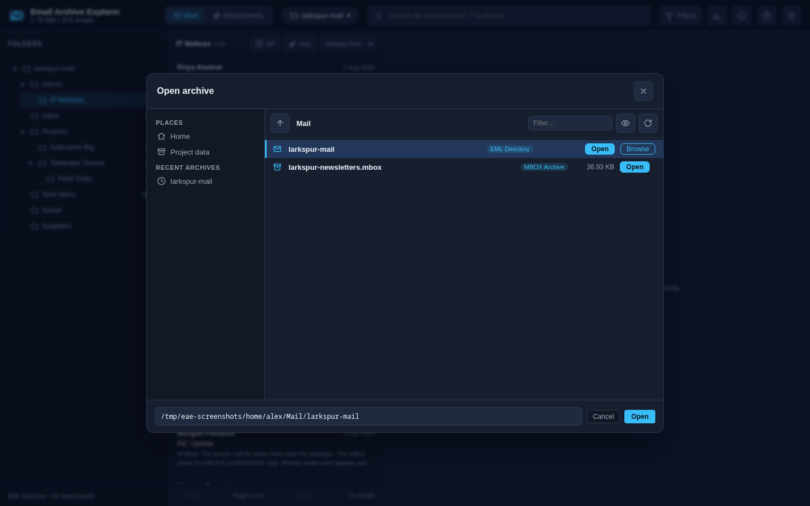

# Email Archive Explorer

[](./LICENSE)


## Background

While cleaning out some storage I came across some old MS PST files that were 25 years old. I'd been meaning to look at them, but I didn't have any Windows or old Office systems to open them with. What I did have was some Google AI credit, so I thought: why not have it build me something that can help me sift through this data and see what's in these archives?

I wrote the specs and kicked off the development while I was mowing my lawn. When I ran out of Google AI credits, I had Claude finish the job. It's not the prettiest from a UI perspective, but it got the job done. And no kidding, I built this while mowing the lawn, just by defining the functionality I wanted as specs and letting the coding agents do the implementation.

**A note on maintenance:** it's unlikely I'll maintain this in any way. Feel free to fork it, submit PRs, etc. if you find it useful. I might even merge them if I have the time next time I'm mowing the lawn. 🙂

## Overview

Browse, search and mine old email archives in your web browser: Outlook `.pst`/`.ost` files, MBOX mailboxes and folders of `.eml` files or Maildirs. It runs locally on Linux or macOS and doesn't need Windows, Outlook or Office.

**Archives are only ever opened read-only, and nothing leaves your machine.** A small SQLite index is built in `.cache/` for fast browsing and search. The server listens on `127.0.0.1` only.


<table><tr>
<td width="50%"></td>
<td width="50%"></td>
</tr></table>

<sub>Screenshots show the built-in fictional demo archive (<code>email-archive demo</code>).</sub>

## Features

- **Mail view:** three-pane layout, conversation detection, full-text search (SQLite FTS5) with filters, `.eml` and ZIP export, analytics timeline
- **Attachments view:** every attachment in one place, noise filtered, duplicates collapsed, **Discover** lenses (largest, rare types, oldest, videos, etc.), inline previews, and a trace back to each file's origin email
- **Multiple archives:** anything in `data/` appears in the 📁 menu, plus a built-in file browser; large archives index in the background
- **Archive Inspector** (`i`): file details, PST header, content statistics, SHA-256
- **Safe by default:** local-only, Host-header check, per-session token, sandboxed HTML mail with remote images blocked
- **Accessible:** full keyboard use, screen-reader roles, WCAG 2.1 AA contrast in light and dark themes

| Format | Detected by | Notes |
|---|---|---|
| Outlook PST / OST | `!BDN` header | ANSI and Unicode, via `libpff-python` |
| MBOX | `From ` envelope line | Unix, Thunderbird, Gmail Takeout |
| EML folder / Maildir | `.eml` files, or `cur/` + `new/` | Sub-directories become folders |

## Quick start

Requires Python 3.11+ and [`uv`](https://docs.astral.sh/uv/).

```bash
git clone <this repository> && cd email-archive-explorer
uv run email-archive demo                          # writes a fictional demo archive to data/demo/
uv run email-archive serve data/demo/larkspur-mail # opens http://127.0.0.1:8000
```

With your own mail:

```bash
uv run email-archive serve ~/Mail/old.pst    # open a specific archive
uv run email-archive serve                   # or start empty and pick one in the browser
```

The first open builds an index (about 5 s for a 415 MB PST); after that it opens in under a second. Press `?` in the app for keyboard shortcuts.

Other commands: `stats`, `index`, `export`, `demo`. Run `uv run email-archive --help` for options. For development and tests, see [CONTRIBUTING.md](./CONTRIBUTING.md).

## Architecture

See **[docs/architecture.md](./docs/architecture.md)** for the full write-up with diagrams.

## Specifications

Development is specification-first. The specs (00–11) live in [`specs/`](./specs/), starting with the [system overview and roadmap](./specs/00-system-overview-and-roadmap.md). To hand a phase to an AI coding tool, see the [execution guide](./specs/AI-TOOL-EXECUTION-GUIDE.md).

## Security and privacy

Local only, no telemetry, no network calls, and mail can't attack the app. Details are in [SECURITY.md](./SECURITY.md).

## License

[MIT](./LICENSE). PST support uses [libpff](https://github.com/libyal/libpff) (LGPL-3.0+) via `libpff-python`.
