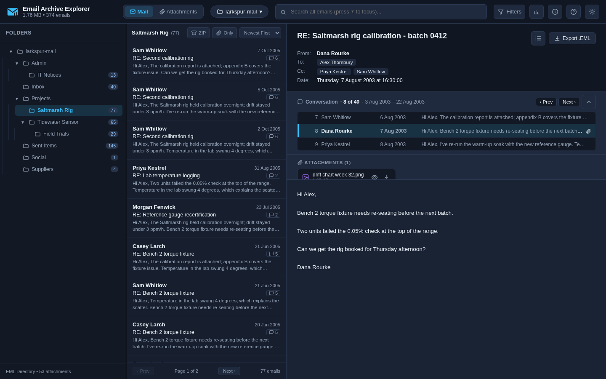
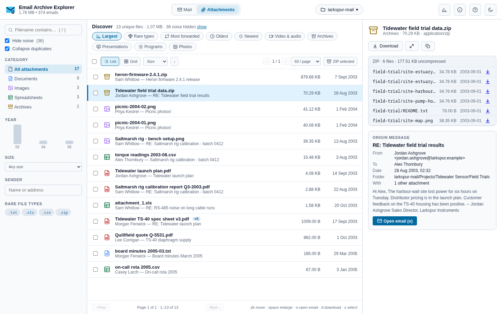

# Email Archive Explorer

[](./LICENSE)


Browse, search and mine old email archives in your web browser: Outlook `.pst`/`.ost` files, MBOX mailboxes and folders of `.eml` files or Maildirs. It runs locally on Linux or macOS (anywhere Python runs) and doesn't need Windows, Outlook or Office.

**Your archives are only ever opened read-only, and nothing leaves your machine.** Nothing is converted, unpacked or modified. A small SQLite index is built in `.cache/` for fast browsing and search. The server listens on `127.0.0.1` only.



<table><tr>
<td width="50%"></td>
<td width="50%"></td>
</tr><tr>
<td><b>Attachments:</b> find the hidden gems and trace each one to its email</td>
<td><b>Open archive:</b> browse to any PST, MBOX or EML folder</td>
</tr></table>

<sub>Screenshots show the built-in fictional demo archive (<code>email-archive demo</code>). Every person, company and file in it is made up.</sub>

---

## Features

- **Mail view**
  - classic three-pane layout: folder tree, message list, reading pane
  - conversations detected from reply headers and Outlook's conversation index, shown as a compact bar (`3 of 12`, Prev/Next) that expands into a scrolling list; the message body always keeps at least 60% of the reading pane
  - full-text search (SQLite FTS5) with date, sender and attachment-type filters
  - `.eml` export, folder and search ZIP export, and an analytics timeline
- **Attachments view: find the hidden gems**
  - every attachment in the archive in one place
  - signature images, stationery and mail-server footers hidden; forwarded duplicates collapsed
  - **Discover** lenses: Largest, Rare types, Most forwarded, Oldest, Videos, Archives, Presentations, Programs, Photos
  - inline previews, including a list of the files inside ZIP/TAR attachments
  - each file's **origin email**, every other email carrying it, and who sent it first
  - **Open email** jumps straight to the source message
- **Multiple archives**
  - everything in `data/` (any supported format) appears in the 📁 menu
  - **Open archive…** shows a file browser covering Home, `data/` and mounted drives, with archives flagged by format; **System dialog…** opens your desktop's own file picker (KDE, GNOME or macOS)
  - large archives index in the background with a progress toast, while the current archive stays usable
- **Archive Inspector** (`i`): file details, PST header (version, ANSI/Unicode, page size, encryption), contents statistics, index status, on-demand SHA-256
- **Safe by default**
  - local-only: no CORS, Host-header check against DNS rebinding, and a per-session token on every state-changing request
  - HTML mail renders in a sandboxed frame with remote images blocked until you allow them
- **Accessible:** full keyboard use (folder tree, message list, dialogs), screen-reader roles, WCAG 2.1 AA contrast in light and dark themes (0 axe-core violations), and reduced motion respected
- **Pluggable formats**
  - format detection by content, not just the extension; new formats plug in as drivers

| Format | Detected by | Notes |
|---|---|---|
| Outlook PST / OST | `!BDN` header | ANSI and Unicode, via `libpff-python`. Embedded Word/Excel documents and attached Outlook items are identified even when Outlook stored no file name. |
| MBOX (`.mbox`, `.mbx`, or no extension) | `From ` envelope line | Unix, Thunderbird, Gmail Takeout. One folder per file. |
| EML folder / Maildir | `.eml` files, or `cur/` + `new/` | Each sub-directory becomes a folder; Maildir++ `.Sub` folders are supported |

---

## Quick start

Everything runs through [`uv`](https://docs.astral.sh/uv/). There's no global install and no Node.js.

```bash
git clone <this repository> && cd email-archive-explorer
uv run email-archive demo                          # writes a fictional demo archive to data/demo/
uv run email-archive serve data/demo/larkspur-mail # opens http://127.0.0.1:8000
```

With your own mail:

```bash
uv run email-archive serve ~/Mail/old.pst    # open a specific archive
uv run email-archive serve                   # or start empty and pick one in the browser
```

- The first open of an archive builds its index: about 5 s for a 415 MB PST with 4,101 messages, about 12 s for 26,000 messages. After that it opens in under a second.
- Put archives in `data/` (git-ignored) and they appear in the **📁 archive** menu. **Open archive…** (`Shift+O`) browses Home, `data/` and mounted drives.
- `--cache-dir DIR` stores the indexes elsewhere. `--reindex` rebuilds the active archive's index.
- `--browse-root PATH` adds a folder to the file browser. A non-loopback `--host` prints a warning and turns the file browser off unless you add `--allow-remote-browse`.

**Requirements:** Python 3.11+ and `uv`. `libpff-python` (PST support) installs from a wheel on common Linux and macOS platforms.

**Keyboard shortcuts**

| Where | Keys |
|---|---|
| Everywhere | `g m` Mail view · `g a` Attachments view · `Shift+O` open archive · `i` Inspector · `?` all shortcuts |
| Mail view | `/` search · `j`/`k` next/previous message · `n`/`p` next/previous in conversation · `t` show/hide conversation · `[` `]` page · `e` export `.eml` · `h` text/HTML body · `Shift+H` compact header |
| Attachments view | `/` filename search · `j`/`k` move · `[` `]` or `PgUp`/`PgDn` page · `space` enlarge preview · `o` open origin email · `d` download · `x` select for ZIP |

**Command line**

```bash
uv run email-archive stats path/to/archive      # summary of the archive in the terminal
uv run email-archive index path/to/archive      # build or refresh its index
uv run email-archive export path/to/archive --out ./emls --limit 50
uv run email-archive demo [--out DIR]           # (re)create the fictional demo archive
```

**Development**

```bash
uv run pytest                                   # runs against the demo archive
EAE_TEST_PST=/path/to/any.pst uv run pytest     # also run the PST-specific tests
uv run ruff check
uv run python scripts/privacy_check.py          # personal-data guard (see CONTRIBUTING.md)
```

See [CONTRIBUTING.md](./CONTRIBUTING.md) for the browser checks (`scripts/ui_audit.py`, `scripts/reading_pane_check.py`) and how screenshots are made.

---

## Architecture

The full write-up, with diagrams, is in **[docs/architecture.md](./docs/architecture.md)**:

| | |
|---|---|
| [](./docs/architecture.md#2-archive-drivers-and-format-detection) | [](./docs/architecture.md#3-indexing-pipeline) |
| **Drivers and format detection:** content probe first, then extension | **Indexing:** cache check, folders, messages and FTS5, derived attachment catalog |
| [](./docs/architecture.md#4-storage-what-lives-in-cache) | [](./docs/architecture.md#5-multiple-archives-and-safe-switching) |
| **Storage:** `catalog.db` plus one disposable `cache_<id>.db` per archive | **Switching:** index first, then swap under a short lock; requests are never cut off |
| [](./docs/architecture.md#6-attachment-explorer) | |
| **Attachment Explorer:** classify, de-duplicate, filter noise, trace each file to its origin | |

### Project layout

```text
src/email_archive_explorer/
├── cli.py              # serve · stats · index · export · demo
├── api.py              # FastAPI app and REST endpoints
├── manager.py          # ArchiveManager: catalog.db, scanning, safe switching
├── indexer.py          # build_index, cache validity, search, thread windows, analytics
├── threads.py          # conversation detection (headers, conversation index, subject fallback)
├── attachments.py      # attachment catalog: categories, duplicates, noise, ZIP/TAR peek
├── models.py           # Pydantic models
├── drivers/
│   ├── base.py         # BaseArchiveDriver interface
│   ├── registry.py     # format detection (probe, then extension)
│   ├── pst_driver.py   # Outlook PST/OST via libpff
│   ├── mbox_driver.py  # MBOX (read-only scanner)
│   ├── eml_dir_driver.py
│   └── rfc822.py       # shared MIME parsing for MBOX/EML
├── fs_browser.py       # confined file browser and native OS file dialog
├── inspector.py        # Archive Inspector facts and SHA-256
├── security.py         # Host-header check and session token
├── demo.py             # fictional demo archive generator
└── static/             # zero-build UI: index.html, icons.svg, css/, js/ (ES modules; app.js is the entry point)
docs/                   # architecture.md, SVG diagrams and screenshots
scripts/                # privacy check, accessibility audit, reading-pane check, screenshot capture
specs/                  # component specifications 00–11 (design history)
tests/                  # pytest suite
```

---

## Specifications

Development is specification-first. Each phase has a spec with acceptance tests.

| # | Spec | Status |
|---|---|---|
| 00 | [System overview and roadmap](./specs/00-system-overview-and-roadmap.md) | — |
| 01 | [Data model and indexer](./specs/01-data-model-and-indexer.md) | ✅ Done |
| 02 | [Backend API](./specs/02-backend-api.md) | ✅ Done |
| 03 | [Web interface](./specs/03-web-interface.md) | ✅ Done |
| 04 | [CLI and runner](./specs/04-cli-and-runner.md) | ✅ Done |
| 05 | [Advanced search, threads, analytics, ZIP export](./specs/05-advanced-features-and-analytics.md) | ✅ Done |
| 06 | [Multi-archive manager and file menu](./specs/06-multi-archive-manager-and-file-menu.md) | ✅ Done |
| 07 | [Pluggable archive drivers](./specs/07-pluggable-archive-driver-architecture.md) | ✅ Done (PST, MBOX, EML/Maildir) |
| 08 | [Modernised UI, file browser, archive inspector](./specs/08-modern-ui-file-browser-and-archive-inspector.md) | ✅ Done |
| 09 | [Attachment explorer](./specs/09-attachment-explorer.md) | ✅ Done |
| 10 | [Conversation threads and reading pane](./specs/10-conversation-threads-and-reading-pane.md) | ✅ Done |
| 11 | [Public release readiness](./specs/11-public-release-readiness.md) | ✅ Done |

To hand a phase to an AI coding tool, see [`specs/AI-TOOL-EXECUTION-GUIDE.md`](./specs/AI-TOOL-EXECUTION-GUIDE.md) for prompts and validation criteria.

---

## Security and privacy

- **Local only.** Binds to `127.0.0.1`, sends no CORS headers, rejects unexpected `Host` headers (DNS rebinding), and requires a per-session token for every state-changing request.
- **Mail can't attack the app.** HTML mail renders in a sandboxed frame with remote images blocked until you allow them; HTML attachments are served with a CSP sandbox.
- **No telemetry, no network calls.** Nothing about your mail leaves your machine.

Details are in [SECURITY.md](./SECURITY.md) and [docs/architecture.md §7](./docs/architecture.md#7-security-model).

## License

[MIT](./LICENSE). PST support uses [libpff](https://github.com/libyal/libpff) (LGPL-3.0+) via `libpff-python`.
