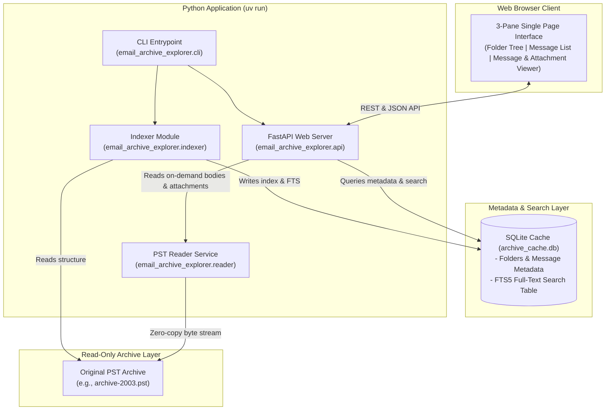
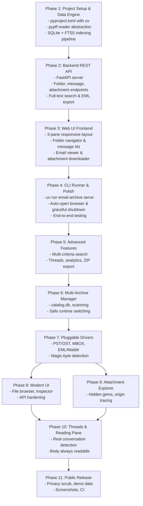

# System Overview & Implementation Roadmap

## 1. Project Objective

Build a local, lightweight, web-based email archive explorer to explore, search, read and extract emails and attachments from legacy Microsoft Outlook Personal Storage (`.pst`/`.ost`) archives, directly on Linux (and cross-platform), **without installing Windows, Microsoft Outlook or legacy Office software**, and **without modifying or unpacking the original archive**. Since Phase 7 the same applies to MBOX mailboxes and folders of `.eml` files or Maildirs.

> The current, as-built architecture (with diagrams) is in [`docs/architecture.md`](../docs/architecture.md). This document records the original blueprint and the roadmap.

All tooling, execution, and dependency management is powered by Python 3.12+ and `uv`.

---

## 2. Technical Stack

| Layer | Technology | Rationale |
|---|---|---|
| **Language & Runtime** | Python 3.12+ via `uv` | Zero-installation runner, cross-platform reproducibility, isolated venvs |
| **Archive drivers** | `libpff-python` (`pypff`) for PST/OST; Python standard library `email` for MBOX/EML | Pluggable `BaseArchiveDriver` interface (Spec 07); PST parsed in place with millisecond reads |
| **Search & Indexing** | SQLite 3 with FTS5 (Full-Text Search) | Fast metadata querying, folder filtering, and instant full-text search with zero external database services |
| **Backend Web API** | `FastAPI` + `uvicorn` | High performance, auto-documented REST API, native streaming responses for attachments |
| **Frontend UI** | Modern Vanilla JS + CSS (3-pane layout) | Zero build steps (no Node.js/npm required), fast, responsive, clean aesthetic (Outlook/Thunderbird style) |
| **CLI & Packaging** | `pyproject.toml` + `argparse` / `click` | Standalone CLI runnable directly with `uv run email-archive` |

---

## 3. High-Level Architecture

The diagram above shows the system as built. The original Phase 1–4 blueprint was:

---

## 4. Component Specification Inventory

This specification suite is organized into independent, modular specifications:

1. **[`01-data-model-and-indexer.md`](./01-data-model-and-indexer.md)**: Data models, SQLite + FTS5 schema, `pypff` integration, and indexing pipeline.
2. **[`02-backend-api.md`](./02-backend-api.md)**: FastAPI endpoints, request/response models, attachment streaming, search querying, and EML generation.
3. **[`03-web-interface.md`](./03-web-interface.md)**: 3-pane email client UI, responsive design, search interface, attachment viewer, and keyboard shortcuts.
4. **[`04-cli-and-runner.md`](./04-cli-and-runner.md)**: CLI command structure, `pyproject.toml` configuration, startup workflow, and packaging.
5. **[`05-advanced-features-and-analytics.md`](./05-advanced-features-and-analytics.md)**: Advanced multi-criteria search, conversation threading, in-app doc viewer, and folder ZIP export.
6. **[`06-multi-archive-manager-and-file-menu.md`](./06-multi-archive-manager-and-file-menu.md)**: Dynamic multi-archive switching, file open menu, directory scanning, and archive catalog.
7. **[`07-pluggable-archive-driver-architecture.md`](./07-pluggable-archive-driver-architecture.md)**: Extensible driver framework (PST/OST, MBOX and EML/Maildir implemented; MSG, OLM and DBX planned) with magic-byte detection.
8. **[`08-modern-ui-file-browser-and-archive-inspector.md`](./08-modern-ui-file-browser-and-archive-inspector.md)**: Modernised UI, server-driven file browser and native OS picker, Archive Inspector panel, and API hardening.
9. **[`09-attachment-explorer.md`](./09-attachment-explorer.md)**: Attachments view: noise filtering, duplicate collapsing, discovery lenses, previews, ZIP/TAR peeking, and origin-message tracing.
10. **[`10-conversation-threads-and-reading-pane.md`](./10-conversation-threads-and-reading-pane.md)**: Correct conversation detection (headers, Outlook conversation index, guarded subject fallback) and a reading pane whose body always stays readable.
11. **[`11-public-release-readiness.md`](./11-public-release-readiness.md)**: Privacy scrub, a fictional demo archive, mock screenshots, and open-source project hygiene ahead of publishing on GitHub.
12. **[`AI-TOOL-EXECUTION-GUIDE.md`](./AI-TOOL-EXECUTION-GUIDE.md)**: Step-by-step handoff guide with exact prompt templates and acceptance criteria for external AI tools.

---

## 5. Implementation Roadmap & Phases

| Phase | Status |
|---|---|
| 1–7 | ✅ Implemented |
| 8 | ✅ Implemented with the recommended answers to §7 (including the accessibility audit) |
| 9 | ✅ Implemented (built before Phase 8; laid out to match Spec 08's planned module structure) |
| 10 | ✅ Implemented with the recommended answers to §8 |
| 11 | ✅ Implemented: fresh repository instead of a history rewrite; other §9 answers as recommended |

### Phase 1: Core Engine & Indexer (`specs/01-data-model-and-indexer.md`)
- Initialize `pyproject.toml` with dependencies (`libpff-python`, `fastapi`, `uvicorn`, `pydantic`).
- Build `PstReader` module that opens PST archives and reads folders, messages, headers, bodies, and attachments.
- Build `Indexer` module that scans the PST on first run and generates `archive_cache.db` with SQLite FTS5 for instant search.
- **Verification:** Unit test running via `uv run pytest` or inspection script indexing `data/mail/archive-2003.pst` in < 5 seconds.

### Phase 2: REST API (`specs/02-backend-api.md`)
- Implement FastAPI routes for:
  - Archive metadata (`/api/archive/info`)
  - Folder tree (`/api/folders`)
  - Message lists with pagination and sorting (`/api/folders/{id}/messages`)
  - Message detail (`/api/messages/{id}`)
  - Attachment streaming with correct MIME type (`/api/messages/{id}/attachments/{att_id}`)
  - EML export (`/api/messages/{id}/eml`)
  - Full-text search (`/api/search`)
- **Verification:** Automated API endpoint tests using `pytest` + `httpx`.

### Phase 3: Web Frontend (`specs/03-web-interface.md`)
- Single-page application served directly from FastAPI static files.
- Left pane: Hierarchical folder tree with unread/total badges.
- Middle pane: Filterable, sortable message list with search highlight, dates, and attachment indicators.
- Right pane: Email viewing pane with headers, formatted body rendering, and attachment action bar.
- Global search bar with instant autocomplete and highlight.
- **Verification:** Manual or headless browser verification of folder switching, message display, and attachment download.

### Phase 4: CLI & Packaging (`specs/04-cli-and-runner.md`)
- Unified CLI command: `uv run email-archive serve data/mail/archive-2003.pst`.
- Automatically builds cache if missing or outdated.
- Launches server, prints local URL (`http://127.0.0.1:8080`), and opens browser.
- **Verification:** Full end-to-end execution with a single `uv run` command.
