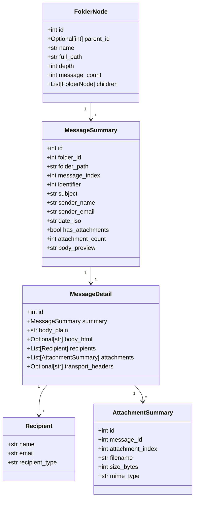

# Component Spec 01: Data Model, PST Reader & SQLite Indexer

## 1. Scope & Purpose

This component is responsible for:
1. Interfacing with Microsoft Outlook `.pst` files in-place using `libpff-python` (`pypff`) in read-only mode without unpacking files to disk.
2. Extracting folder trees, message headers, plain/RTF message bodies, recipient lists, and attachment metadata.
3. Building and maintaining a high-performance SQLite cache database (`archive_cache.db`) equipped with FTS5 (Full-Text Search) for sub-millisecond querying.
4. Providing zero-copy on-demand streaming of attachment payloads and message bodies directly from the untouched PST file.

---

## 2. Dependencies & Environment

All dependencies are defined for use with `uv`:
- **`libpff-python`**: Joachim Metz's open-source library for reading Outlook PFF/PST/OST formats.
- **`sqlite3`**: Python standard library (compiled with FTS5 enabled).
- **`pydantic`**: For schema definitions and type validation.
- **`python-magic`** or standard **`mimetypes`**: For attachment content-type inference.

---

## 3. Data Models



---

## 4. Database Schema (`archive_cache.db`)

The SQLite cache stores metadata and search tokens. The original `.pst` remains the single source of truth for raw body content and attachment bytes.

```sql
-- Metadata tracking table for cache invalidation
CREATE TABLE IF NOT EXISTS archive_meta (
    key TEXT PRIMARY KEY,
    value TEXT
);

-- Hierarchical folder records
CREATE TABLE IF NOT EXISTS folders (
    id INTEGER PRIMARY KEY AUTOINCREMENT,
    parent_id INTEGER,
    name TEXT NOT NULL,
    full_path TEXT NOT NULL UNIQUE,
    depth INTEGER NOT NULL,
    message_count INTEGER DEFAULT 0,
    FOREIGN KEY (parent_id) REFERENCES folders(id)
);

CREATE INDEX IF NOT EXISTS idx_folders_parent ON folders(parent_id);

-- Indexed message metadata for fast browsing and sorting
CREATE TABLE IF NOT EXISTS messages (
    id INTEGER PRIMARY KEY AUTOINCREMENT,
    folder_id INTEGER NOT NULL,
    folder_path TEXT NOT NULL,
    message_index INTEGER NOT NULL,
    identifier INTEGER NOT NULL,
    subject TEXT,
    sender_name TEXT,
    sender_email TEXT,
    recipients_json TEXT, -- JSON array of {name, email, type}
    date_iso TEXT,        -- ISO 8601 string (e.g. 2002-11-29T10:15:00)
    has_attachments INTEGER DEFAULT 0,
    attachment_count INTEGER DEFAULT 0,
    body_preview TEXT,    -- First 250 characters of plain text
    FOREIGN KEY (folder_id) REFERENCES folders(id)
);

CREATE INDEX IF NOT EXISTS idx_messages_folder ON messages(folder_id);
CREATE INDEX IF NOT EXISTS idx_messages_date ON messages(date_iso DESC);
CREATE INDEX IF NOT EXISTS idx_messages_sender ON messages(sender_name);

-- Attachment metadata for fast lookup
CREATE TABLE IF NOT EXISTS attachments (
    id INTEGER PRIMARY KEY AUTOINCREMENT,
    message_id INTEGER NOT NULL,
    attachment_index INTEGER NOT NULL,
    filename TEXT NOT NULL,
    size_bytes INTEGER NOT NULL,
    mime_type TEXT,
    FOREIGN KEY (message_id) REFERENCES messages(id)
);

CREATE INDEX IF NOT EXISTS idx_attachments_msg ON attachments(message_id);

-- SQLite FTS5 Full-Text Search Virtual Table
CREATE VIRTUAL TABLE IF NOT EXISTS messages_fts USING fts5(
    message_id UNINDEXED,
    subject,
    sender,
    recipients,
    body_plain,
    content='messages',
    content_rowid='id'
);
```

---

## 5. PST Reader Abstraction (`pst_reader.py`)

A thread-safe reader class wrapping `pypff`:

```python
class PstReader:
    def __init__(self, pst_path: str | Path):
        self.pst_path = str(pst_path)
        self._pst = None

    def open(self):
        """Opens the PST file in read-only mode."""
        self._pst = pypff.file()
        self._pst.open(self.pst_path)

    def close(self):
        if self._pst:
            self._pst.close()
            self._pst = None

    def get_message(self, folder_path: str, message_index: int):
        """Traverses to target folder and retrieves the specific sub-message."""
        # Traversal logic by folder segments
        ...

    def get_attachment_stream(self, folder_path: str, message_index: int, attachment_index: int) -> bytes:
        """Extracts attachment byte buffer on-demand."""
        ...
```

### String Decoding Rules
ANSI PST files store strings in 8-bit character sets (e.g. Windows-1252 / ISO-8859-1).
1. Message bodies and strings must be decoded with fallback:
   ```python
   def decode_bytes(data: bytes | str | None) -> str:
       if data is None:
           return ""
       if isinstance(data, str):
           return data
       for enc in ("utf-8", "cp1252", "latin-1"):
           try:
               return data.decode(enc)
           except UnicodeDecodeError:
               continue
       return data.decode("utf-8", errors="replace")
   ```
2. For messages where `get_plain_text_body()` returns empty but `get_rtf_body()` contains data, RTF control words should be stripped or parsed to plain text using standard regex or `striprtf`.

### Recipient Extraction Rules
`pypff.message.recipients` returns a list of MAPI record sets.
Extract standard MAPI properties:
- `0x3001` (PR_DISPLAY_NAME) -> Recipient display name
- `0x3003` (PR_EMAIL_ADDRESS) -> Recipient email address
- `0x0c15` (PR_RECIPIENT_TYPE) -> `1` for To, `2` for Cc, `3` for Bcc.

---

## 6. Indexing Pipeline (`indexer.py`)

1. **Cache Validation Check:**
   - Compares PST file size, last modified timestamp, and SHA256 of the header (first 4KB).
   - If `archive_meta` in SQLite matches current file properties, the indexing phase is skipped immediately (< 10ms startup).
2. **Recursive Traversal:**
   - Starts at `root_folder`.
   - Iterates through subfolders recursively.
   - For each message:
     - Extracts headers, sender, date, attachment summaries.
     - Extracts text body (for FTS5 index and preview).
     - Inserts records using a single SQLite transaction with batch commits every 500 messages.
3. **FTS Population:**
   - Populates `messages_fts` concurrently with message insertion.
4. **Performance Target:**
   - 4,100 messages must index in **under 10 seconds** on standard hardware.

---

## 7. Verification & Test Suite

Create `tests/test_indexer.py` executable with:
```bash
uv run pytest tests/test_indexer.py -v
```

The test must verify:
- Can open `archive-2003.pst` without error.
- Counts match: 135 folders, 4,101 messages.
- Can extract an attachment byte stream and verify its magic signature.
- SQLite database is created, populated, and responds to an FTS5 query in < 2ms.
