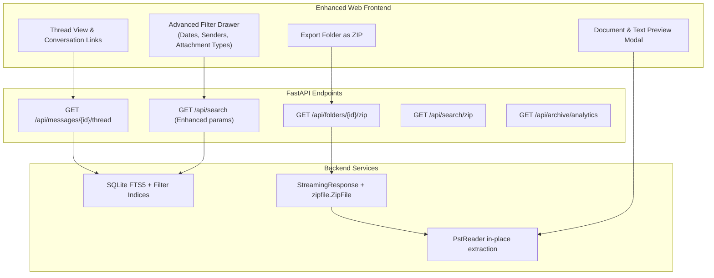

# Component Spec 05: Advanced Search, Thread Grouping, Zip Export & Document Preview

## 1. Scope & Purpose

This component enhances the Email Archive Explorer with:
1. **Multi-Criteria Advanced Filtering:** Date range, sender filtering, attachment type filter (PDF, Docs, Excel, Images), and folder-scoped searching.
2. **Conversation Threading:** Grouping messages by conversation topic (`conversation_topic` or normalized subject), showing thread counts and quick navigation between related emails.
3. **Folder & Search ZIP Export:** On-demand ZIP streaming of `.eml` files for any folder or search result set without creating temporary files on disk.
4. **Inline Document & Code/Log Preview:** In-app modal viewer for `.pdf`, `.txt`, `.log`, `.csv`, and code attachments in addition to images.
5. **Archive Analytics & Visual Timeline:** Summary view showing email volume per month across 2000–2003, top correspondence partners, and storage breakdowns.

---

## 2. Architecture & Data Flow



---

## 3. Detailed Specifications

### 3.1. Enhanced Search & Filter Query Parameters
Enhance `GET /api/search` and `GET /api/folders/{folder_id}/messages`:
- `date_from` (ISO date string, e.g. `2001-01-01`)
- `date_to` (ISO date string, e.g. `2002-12-31`)
- `sender` (string, partial or exact sender match)
- `attachment_ext` (string, e.g. `pdf`, `doc`, `xls`, `jpg`)
- `scope` (`folder` or `global`)

### 3.2. Conversation Threading
Outlook messages share conversation topics or subjects prefixed with `RE:`, `FW:`, `FWD:`.
1. **Normalization Function:**
   ```python
   def normalize_subject(subject: str) -> str:
       clean = re.sub(r'^(re|fw|fwd|aw|sv):\s*', '', subject, flags=re.IGNORECASE)
       return clean.strip().lower()
   ```
2. **Endpoint `GET /api/messages/{message_id}/thread`:**
   - Returns all messages sharing the same normalized subject.
   - Ordered chronologically by `date_iso ASC`.
   - Response model: `List[MessageSummary]`.

### 3.3. Folder & Search ZIP Export (Zero Disk Footprint)
Stream standard ZIP archives generated dynamically in memory using Python's `zipfile.ZipFile`:
1. **Endpoint `GET /api/folders/{folder_id}/zip`:**
   - Generates `.eml` for each message in the folder.
   - Streams `application/zip` with `Content-Disposition: attachment; filename="<folder_name>.zip"`.
2. **Endpoint `GET /api/search/zip`:**
   - Generates `.eml` for each search result (up to 500 items).

### 3.4. In-App Document & Text Preview
1. Text/Log/CSV preview:
   - When attachment MIME is `text/plain`, `text/csv`, `text/html`, or file extension is `.txt`, `.log`, `.ini`, `.dat`:
   - Clicking `[👁️ View]` fetches text and renders in a modal with monospace formatting and line numbers.
2. PDF preview:
   - When MIME is `application/pdf`, open inline viewer in a modal or new browser tab with browser's built-in PDF viewer.

### 3.5. Analytics & Timeline Data
**Endpoint `GET /api/archive/analytics`:**
- Returns:
  - Monthly distribution: array of `{ "month": "2001-03", "count": 142 }` from October 2000 to August 2003.
  - Top 10 senders and message counts.
  - Top 10 attachment extensions with file counts and total byte volume.

---

## 4. Test Suite Requirements (`tests/test_advanced.py`)

- `test_search_date_range_filter`: Verify results fall strictly within specified dates.
- `test_search_attachment_type_filter`: Verify results only include messages with specific attachment extensions.
- `test_message_thread`: Verify messages in a thread are returned in chronological order.
- `test_folder_zip_export`: Verify streamed response is a valid ZIP file containing `.eml` entries.
- `test_archive_analytics`: Verify monthly timeline data matches total message counts.
