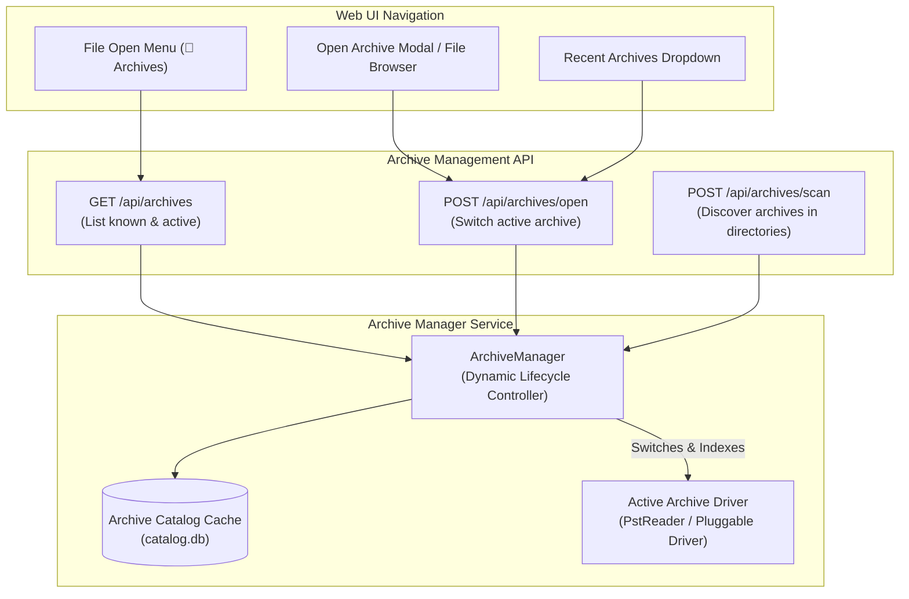

# Component Spec 06: Multi-Archive Manager & File Open Menu

## 1. Scope & Purpose

This component provides a **File Open & Archive Switcher** system that allows users to:
1. Discover, browse, and select between multiple email archive files via a top-level menu in the web interface.
2. Switch active archives dynamically at runtime without restarting the Python server.
3. Automatically discover archives placed into workspace data folders (e.g. `data/`).
4. Manually open any archive on the file system by path.
5. Maintain an archive catalog of recently opened archives with metadata, size, and message counts.

---

## 2. Architectural Blueprint



---

## 3. Data Models & Catalog Schema

### 3.1. Archive Entry Model
```python
class ArchiveEntry(BaseModel):
    id: str                  # Deterministic hash of file path (e.g. sha256 prefix)
    name: str                # File basename (e.g. archive-2003.pst)
    file_path: str           # Absolute path
    format_type: str         # 'pst', 'mbox', 'eml_dir', etc.
    file_size_bytes: int
    file_size_formatted: str
    is_active: bool
    total_messages: int
    total_folders: int
    last_opened_iso: Optional[str]
```

### 3.2. Catalog Database (`data/catalog.db`)
```sql
CREATE TABLE IF NOT EXISTS known_archives (
    id TEXT PRIMARY KEY,
    name TEXT NOT NULL,
    file_path TEXT NOT NULL UNIQUE,
    format_type TEXT NOT NULL,
    file_size_bytes INTEGER NOT NULL,
    total_messages INTEGER DEFAULT 0,
    total_folders INTEGER DEFAULT 0,
    last_opened_iso TEXT,
    last_scanned_iso TEXT
);

CREATE TABLE IF NOT EXISTS scan_directories (
    path TEXT PRIMARY KEY,
    recursive INTEGER DEFAULT 1
);
```

### 3.3. Cache Storage Strategy per Archive
To keep indexes isolated, fast, and corruption-free, each opened archive gets its own independent SQLite cache file derived from its canonical path:
```text
.cache/
├── catalog.db
├── cache_a1b2c3d4.db    # Cache for data/mail/archive-2003.pst
└── cache_e5f6g7h8.db    # Cache for data/personal/archive_2005.pst
```

---

## 4. API Endpoints Specification

### 4.1. `GET /api/archives`
Lists all known archives, their status, email counts, and identifies the currently active archive.

**Response (`200 OK`):**
```json
{
  "active_archive_id": "a1b2c3d4",
  "archives": [
    {
      "id": "a1b2c3d4",
      "name": "archive-2003.pst",
      "file_path": "/home/you/email-archive-explorer/data/mail/archive-2003.pst",
      "format_type": "pst",
      "file_size_formatted": "415.41 MB",
      "is_active": true,
      "total_messages": 4101,
      "total_folders": 134,
      "last_opened_iso": "2026-11-07T18:00:00"
    }
  ]
}
```

### 4.2. `POST /api/archives/open`
Switches the server's active archive to the requested file.

**Request Body:**
```json
{
  "file_path": "/path/to/another_archive.pst"
}
```

**Behavior:**
1. Validates file existence and read permissions.
2. Gracefully closes active archive driver handles.
3. Automatically triggers indexing for the new archive if cache is missing.
4. Mounts the new archive as active for all `/api/folders`, `/api/messages`, and `/api/search` queries.
5. Updates `catalog.db` with latest timestamp.

**Response (`200 OK`):**
Returns the activated `ArchiveEntry` with updated metadata.

### 4.3. `POST /api/archives/scan`
Scans specified directories (defaults to `data/`) for supported archive extensions.

**Request Body (Optional):**
```json
{
  "directory": "data/",
  "recursive": true
}
```

**Response (`200 OK`):**
```json
{
  "discovered_count": 3,
  "newly_added": [
    "data/mail/archive-2003.pst",
    "data/personal/old_mail.pst"
  ]
}
```

---

## 5. Frontend UI/UX Specification

```text
+----------------------------------------------------------------------------------------------------+
|  [📁 Archives v] [Active: archive-2003.pst (4,101)] | [ Search emails... (Ctrl+/) ] | [📊] [☀️]     |
|   ├── ● archive-2003.pst (415 MB • 4,101 msgs)      |                                                |
|   ├──   Project_2004.pst (120 MB • 850 msgs)      |                                                |
|   ├─────────────────────────────────────────      |                                                |
|   ├── ➕ Open File Path...                         |                                                |
|   └── 🔄 Rescan Data Folder                       |                                                |
+----------------------------------------------------------------------------------------------------+
```

### UI Components:
1. **Top Nav "Archives" Dropdown Menu:**
   - Displays current archive name and message badge.
   - Click reveals popover menu listing all discovered archives.
   - Active archive marked with distinct indicator dot (`●`).
   - Clicking any archive triggers instant dynamic switch with loading spinner.
2. **"Open File Path..." Modal:**
   - Text input with file path auto-complete or paste.
   - Validates existence and supported format extension.
3. **"Rescan Data Folder" Button:**
   - One-click rescan of `data/` directory to discover newly copied archive files.

---

## 6. Acceptance Criteria & Test Plan (`tests/test_archive_manager.py`)

1. **Discovery Test:** Placing 2 distinct PST files in `data/` and calling `POST /api/archives/scan` detects both files.
2. **Switching Test:** Calling `POST /api/archives/open` switches active archive; subsequent calls to `GET /api/folders` and `GET /api/archive/info` return data corresponding exclusively to the newly selected archive.
3. **Thread Safety Test:** Concurrent requests during archive switching do not throw file descriptor errors or access invalid memory.
4. **Cache Isolation Test:** Two different archives maintain completely independent SQLite cache files without table pollution.
