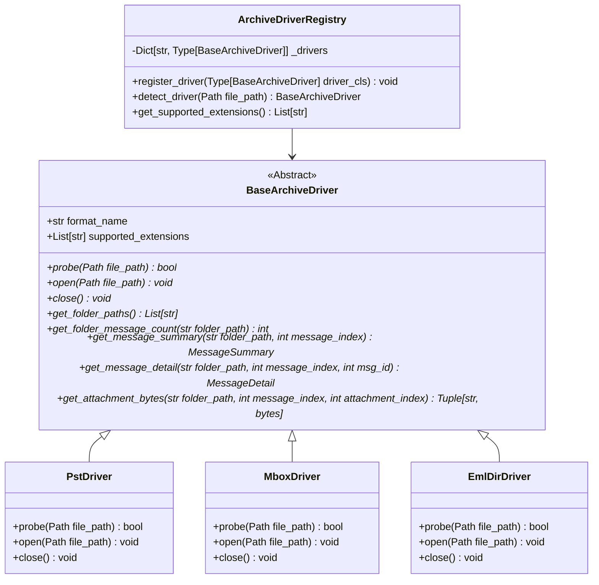

# Component Spec 07: Pluggable Archive Driver Architecture

> **Status: implemented** (PST/OST, MBOX, EML directory / Maildir). Code: `src/email_archive_explorer/drivers/`. Tests: `tests/test_drivers.py`.
>
> **Differences from this spec, as built:**
> - Probe order is PST, MBOX, then EML; registration order is probe order. Missing paths raise `FileNotFoundError`; unsupported ones raise `ValueError`.
> - `MboxDriver` doesn't use `mailbox.mbox`, which opens files read-write (`rb+`). It scans message boundaries itself and opens the file `rb` only. It requires a `From ` envelope line containing a 4-digit year, and undoes `>From ` quoting.
> - Optional hooks on the base class:
>   - `describe()`: format plus version, e.g. "Outlook PST (ANSI, Outlook 97–2002)" from the header's `wVer`
>   - `fingerprint()`: size and mtime; for directories, the total bytes and newest mtime
>   - `get_message_for_index()`: skips HTML and headers for speed
>   - `get_raw_message()`: original RFC 822 bytes, so MBOX/EML `.eml` export is lossless
>   - `index_version`: bumping it invalidates caches built by an older version of the driver
> - `PstDriver` caches libpff folder objects per path. Creating a folder object costs about 14 ms in libpff, and without the cache indexing took 68 s instead of 5 s.
> - `reader.PstReader` was kept as an alias of `PstDriver` for backward compatibility (removed in Spec 11).

## 1. Scope & Purpose

This component defines the **Pluggable Archive Driver Framework**, an extensible abstraction layer that enables the Email Archive Explorer to open, index, read, and extract messages from **any email archive format** without altering the database schema, indexing engine, REST API, or web UI.

### Planned Format Support
| Driver | File Formats | Underlying Library | Status |
|---|---|---|---|
| **`PstDriver`** | `.pst`, `.ost` (ANSI & Unicode) | `libpff-python` (`pypff`) | Current Production |
| **`MboxDriver`** | `.mbox`, `.mbx` (Unix / Thunderbird) | Python standard `mailbox.mbox` | Planned (Phase 6) |
| **`EmlDirDriver`** | Directory of `.eml` files / Maildir | Python standard `email` + `pathlib` | Planned (Phase 6) |
| **`MsgDriver`** | Individual `.msg` files / folders | `extract-msg` / standard library | Planned (Phase 7) |
| **`OlmDriver`** | `.olm` (Outlook for Mac archives) | Standard library `zipfile` + XML parser | Planned (Phase 7) |

---

## 2. Pluggable Architecture Design



---

## 3. Core Interface Definition (`base_driver.py`)

All drivers inherit from `BaseArchiveDriver`:

```python
from abc import ABC, abstractmethod
from pathlib import Path
from typing import List, Optional, Tuple
from email_archive_explorer.models import MessageDetail, MessageSummary

class BaseArchiveDriver(ABC):
    """Abstract driver interface that all format drivers must satisfy."""

    def __init__(self, file_path: Path):
        self.file_path = Path(file_path).resolve()
        self.is_open = False

    @classmethod
    @abstractmethod
    def format_name(cls) -> str:
        """Human-readable format name (e.g. 'Outlook PST', 'MBOX Mailbox')."""
        ...

    @classmethod
    @abstractmethod
    def supported_extensions(cls) -> List[str]:
        """List of lower-case file extensions (e.g. ['.pst', '.ost'])."""
        ...

    @classmethod
    @abstractmethod
    def probe(cls, file_path: Path) -> bool:
        """Inspects magic header bytes or file structure to confirm compatibility."""
        ...

    @abstractmethod
    def open(self) -> None:
        """Opens the archive file in read-only mode."""
        ...

    @abstractmethod
    def close(self) -> None:
        """Releases underlying file descriptors."""
        ...

    @abstractmethod
    def get_folder_paths(self) -> List[str]:
        """Returns list of all canonical folder paths."""
        ...

    @abstractmethod
    def get_folder_message_count(self, folder_path: str) -> int:
        """Returns message count for a folder."""
        ...

    @abstractmethod
    def get_message_detail(
        self, folder_path: str, message_index: int, msg_id: int = 0
    ) -> MessageDetail:
        """Retrieves full message details, headers, body, and attachment metadata."""
        ...

    @abstractmethod
    def get_attachment_bytes(
        self, folder_path: str, message_index: int, attachment_index: int
    ) -> Tuple[str, bytes]:
        """Extracts raw attachment payload on-demand."""
        ...
```

---

## 4. Format Probing & Magic Byte Identification

Drivers do not rely solely on file extensions. They probe binary file signatures:

| Format | Magic Bytes / Header Signature | Detection Rule |
|---|---|---|
| **Outlook PST/OST** | `!BDN` (`0x21 0x42 0x44 0x4E`) at byte offset 0 | Checks first 4 bytes match Outlook storage header |
| **MBOX** | `From ` (`0x46 0x72 0x6F 0x6D 0x20`) at byte offset 0 | First line begins with mbox envelope separator |
| **EML File / Directory** | `Date:`, `From:`, `Subject:`, or `MIME-Version:` | Checks for standard RFC 822 header keys |
| **Outlook for Mac (.OLM)** | `PK\x03\x04` containing `message.xml` or `com.microsoft.outlook` | Standard ZIP container containing Microsoft XML manifests |
| **Outlook MSG** | `\xD0\xCF\x11\xE0\xA1\xB1\x1A\xE1` (OLE CFBF compound file) | Standard Compound File Binary Format signature |

### Driver Registry Dispatcher (`registry.py`):
```python
class ArchiveDriverRegistry:
    _registry: Dict[str, Type[BaseArchiveDriver]] = {}

    @classmethod
    def register(cls, driver_cls: Type[BaseArchiveDriver]):
        cls._registry[driver_cls.format_name()] = driver_cls

    @classmethod
    def detect_driver(cls, file_path: Path) -> BaseArchiveDriver:
        path = Path(file_path).resolve()
        # Pass 1: Magic byte probing
        for driver_cls in cls._registry.values():
            if driver_cls.probe(path):
                return driver_cls(path)

        # Pass 2: Extension fallback
        ext = path.suffix.lower()
        for driver_cls in cls._registry.values():
            if ext in driver_cls.supported_extensions():
                return driver_cls(path)

        raise ValueError(f"Unsupported archive format: {path.name}")
```

---

## 5. Reference Implementation: MBOX Driver Plumbing (`mbox_driver.py`)

Using Python's standard library `mailbox.mbox` (zero extra dependencies required):

```python
import mailbox
from pathlib import Path
from email_archive_explorer.drivers.base import BaseArchiveDriver

class MboxDriver(BaseArchiveDriver):
    @classmethod
    def format_name(cls) -> str:
        return "MBOX Archive"

    @classmethod
    def supported_extensions(cls) -> List[str]:
        return [".mbox", ".mbx"]

    @classmethod
    def probe(cls, file_path: Path) -> bool:
        try:
            with open(file_path, "rb") as f:
                header = f.read(5)
                return header.startswith(b"From ")
        except Exception:
            return False

    def open(self) -> None:
        self._mbox = mailbox.mbox(str(self.file_path), create=False)
        self.is_open = True

    def close(self) -> None:
        if self._mbox:
            self._mbox.close()
            self._mbox = None
            self.is_open = False

    def get_folder_paths(self) -> List[str]:
        # MBOX files are flat by default or nested via directory trees
        return ["Inbox"]
```

---

## 6. Directory Layout for Extensible Drivers

```text
src/email_archive_explorer/
├── drivers/
│   ├── __init__.py           # Auto-registers built-in drivers
│   ├── base.py               # BaseArchiveDriver abstract class
│   ├── registry.py           # ArchiveDriverRegistry & probe logic
│   ├── pst_driver.py         # Concrete driver wrapping pypff
│   ├── mbox_driver.py        # Concrete driver for MBOX files
│   └── eml_dir_driver.py     # Concrete driver for EML directories
├── manager.py                # Multi-archive manager service
├── indexer.py                # Uses BaseArchiveDriver (100% format agnostic)
└── api.py                    # Consumes ArchiveManager
```

---

## 7. Acceptance Criteria & Test Plan (`tests/test_drivers.py`)

1. **Interface Compliance Test:** All concrete drivers implement 100% of `BaseArchiveDriver` abstract methods.
2. **Probing Accuracy:**
   - Probing a real `.pst` file returns `PstDriver`.
   - Probing a synthetic `.mbox` file returns `MboxDriver`.
   - Probing an unsupported format (e.g. `.png`) raises clean `ValueError`.
3. **Pluggable Indexing Test:** The existing `build_index()` function successfully indexes a non-PST archive (e.g. a small test `.mbox`) into SQLite without modifying `indexer.py` or the database schema.
4. **Attachment Extraction Test:** Attachments extracted through any driver return valid byte buffers and MIME headers.
