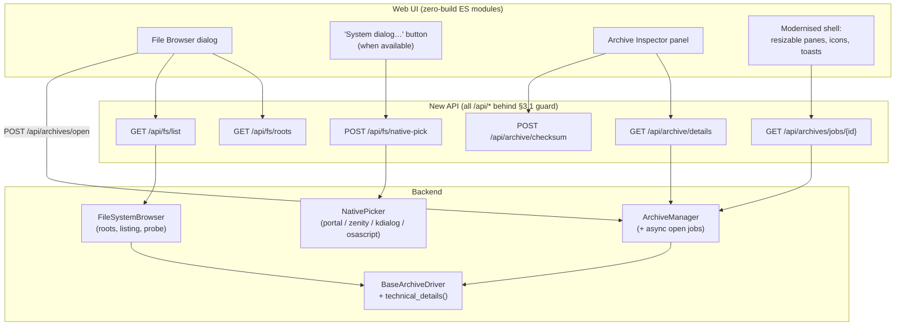

# Component Spec 08: Modernised UI, File Browser & Archive Inspector

> **Status: implemented**, using the recommended answers to §7: browse Home, `data/` and mounted drives (plus `--browse-root`); show **System dialog…** when available; Inspector hidden until toggled and remembered; current palette refined.
>
> | Slice | As built |
> |---|---|
> | 8.1 Hardening | `security.py`: no CORS, Host check (421), session token on POSTs and `/api/fs/*`, `--allow-remote-browse`. Read-only `GET`s stay token-free, since the no-CORS and Host checks protect them, and attachment links and `` previews keep working. |
> | 8.2 File system API | `fs_browser.py`. The native picker uses **kdialog / zenity / osascript / tkinter**, not `xdg-desktop-portal`. Portal support over D-Bus would need a new dependency; kdialog gives the native KDE dialog on this machine. |
> | 8.3 Async open | `ArchiveManager.start_open_job()`, `GET /api/archives/jobs/{id}`, `wait` and `force_reindex` request fields; the UI shows a progress toast |
> | 8.4 Inspector data | `inspector.py`, `technical_details()` on every driver, `index_duration_s`, cached SHA-256 |
> | 8.5 Visual system | `css/shell.css` tokens, an SVG icon sprite for the header, tabs and dialogs, toasts in place of `alert()`, native `<dialog>`, theme follows the OS by default |
> | 8.6 Layout | Pane splitters in the Mail view (drag, arrow keys, double-click to reset; widths remembered); the Attachments view stacks at narrow widths |
> | 8.7 File Browser | `js/filebrowser.js` |
> | 8.8 Inspector panel | `js/inspector.js` |
> | 8.9 Extras | Sandboxed Text/HTML body toggle (`h`) with remote images blocked until allowed; `?` shortcut help |
>
> **Completed in the wrap-up pass** (originally deferred):
> - **ES modules (§4.6):** `index.html` loads one `<script type="module" src="js/app.js">`. Every file imports its dependencies explicitly, and `ui.js` loads first because it installs the token-sending `fetch` wrapper. Files keep their names rather than moving into `ui/`; that's cosmetic.
> - **Skeleton loaders (§4.5.2)** for the folder tree, message list and attachment results, with `aria-busy` while loading and no animation under reduced motion.
> - **ARIA (§4.5.5):**
>   - the folder tree is `role=tree` with `treeitem`, `group`, `aria-level`, `aria-expanded` and `aria-selected`, a roving tabindex, and arrow/Home/End/Enter keys
>   - the message list is `role=listbox` with `option` and `aria-selected`; the focused message opens with Enter
>   - attachment results are a `list`; the splitters expose `aria-valuenow`
> - **Icons:** every emoji in the interface is now a sprite icon. File types are colour-tinted by kind (`UI.fileIcon`).
> - **Accessibility audit:** axe-core (WCAG 2.1 A/AA plus best practice) via `scripts/ui_audit.py` reports **0 violations** on the Mail view, Attachments view, File Browser, Help and Inspector, in both themes. Fixes were:
>   - `--text-muted` raised to 4.5:1 or better in both themes
>   - light-theme accent darkened to `#0369a1`
>   - dark text on primary buttons
>   - empty folders de-emphasised by colour rather than opacity
>   - an `<h1>`, labelled landmarks and labelled selects
>
>   Lighthouse itself needs Node, so axe-core (the engine Lighthouse's accessibility audit uses) was run directly.

## 1. Scope & Purpose

This phase does three things:

1. **Modernises the web interface**: a consistent visual system, real icons, resizable panes, accessible dialogs, and proper loading, empty and error states.
2. **Replaces "Open File Path..." with a file explorer.** Users browse to an archive by clicking through folders instead of typing a path.
3. **Adds an Archive Inspector panel** showing technical detail about the open archive: format and version, header fields, encryption, file metadata, content statistics, and the state of the search index.

It builds on Spec 06 (archive manager) and Spec 07 (drivers). It does **not** change the database schema, the indexer, or any existing endpoint's response shape.

### 1.1. Current State (as of Spec 07)

| Area | Today | Problem |
|---|---|---|
| Open archive | Text box for a full path | Users must know and type absolute paths |
| Icons | Emoji (📁 📊 ☀️ 🔍) | Render differently per OS/font, can't be styled, poor at small sizes |
| Dialogs | Custom `div.modal-overlay` elements | No focus trap, inconsistent Escape handling, not announced to screen readers |
| Errors | `alert()` on a failed switch | Blocks the page, can't be styled |
| Layout | Fixed 3-pane widths | Panes can't be resized or collapsed; poor on narrow windows |
| Switching / indexing | Indeterminate overlay | Opening a large new archive blocks for many seconds with no progress |
| HTML email | Only `body_plain` is rendered | MBOX/EML mail is often HTML-only; formatting is lost |
| Archive details | Subtitle shows size and count only | No way to see format version, encryption, index state, etc. |
| API exposure | `CORSMiddleware(allow_origins=["*"])` | **Any website open in the browser can read the local API** (see §3.1) |

### 1.2. Non-Goals

- No frontend framework or build step. The zero-build principle from Spec 03 stays: plain HTML, CSS, and ES modules served from `static/`.
- No multi-user or remote-hosting features.
- No uploading of archives (they are routinely hundreds of MB to many GB; the server already runs on the user's machine and reads them in place).

---

## 2. Architectural Blueprint



---

## 3. Backend

### 3.1. Prerequisite: Lock Down the Local API

A file-system browsing endpoint can't ship on top of the current wildcard CORS policy. Today any page the user visits can `fetch("http://127.0.0.1:8000/api/search?q=...")` and read the results. Listing directories would extend that exposure to the whole home folder. This work must land first.

1. **Remove wildcard CORS.** The UI is same-origin, so it needs no CORS at all. Drop `CORSMiddleware` (or allow only the server's own origin).
2. **Host header check** against DNS rebinding: reject requests whose `Host` isn't `127.0.0.1:<port>`, `localhost:<port>` or `[::1]:<port>` (plus the `--host` value if set). Return `421 Misdirected Request`.
3. **Session token for sensitive routes.** On startup, generate a random token (`secrets.token_urlsafe(32)`). Inject it into `index.html` as `<meta name="eae-token">`, and require an `X-EAE-Token` header on every `/api/fs/*` route and on `POST` routes. Attachment and `.eml` download links (plain `GET` navigations) remain token-free; they are covered by items 1 and 2.
4. If `serve --host` is anything other than loopback, print a warning, and disable `/api/fs/*` unless `--allow-remote-browse` is passed.

**Tests:** cross-origin `fetch` gets no `Access-Control-Allow-Origin`, a forged `Host` gets 421, and `/api/fs/list` without the token gets 403.

### 3.2. File System Browser Service (`fs_browser.py`)

**Why not a browser `<input type="file">`?** Browsers deliberately hide the real path of a chosen file and would force an upload. A file picker therefore has to be driven by the local server, which already has file system access.

**Roots** (`GET /api/fs/roots`):
```json
{
  "roots": [
    {"label": "Home", "path": "/home/you", "kind": "home"},
    {"label": "Project data", "path": "/home/you/email-archive-explorer/data", "kind": "data"},
    {"label": "Recent", "path": null, "kind": "recent"},
    {"label": "USB-DRIVE", "path": "/run/media/you/USB-DRIVE", "kind": "mount"}
  ],
  "native_picker_available": true
}
```
- `mount` entries come from `/run/media/$USER/*`, `/media/$USER/*` and `/mnt/*` (Linux), `/Volumes/*` (macOS), or drive letters (Windows).
- `recent` is served from `catalog.db` (`last_opened_iso`).
- **Browsing is confined to the roots and their descendants.** Paths are resolved (`Path.resolve()`) before the containment check, so `..` and symlinks can't escape. Configure with `serve --browse-root PATH` (repeatable).

**Listing** (`GET /api/fs/list?path=…&show_hidden=false`):
```json
{
  "path": "/home/you/Mail",
  "parent": "/home/you",
  "breadcrumbs": [{"name": "you", "path": "/home/you"}, {"name": "Mail", "path": "/home/you/Mail"}],
  "entries": [
    {"name": "Thunderbird", "path": "…", "type": "dir", "archive": null, "modified_iso": "…"},
    {"name": "Exported", "path": "…", "type": "dir",
     "archive": {"format_type": "eml_dir", "format_name": "EML Directory"}},
    {"name": "old.pst", "path": "…", "type": "file", "size_bytes": 435585024,
     "size_formatted": "415.41 MB", "modified_iso": "…",
     "archive": {"format_type": "pst", "format_name": "Outlook PST"}},
    {"name": "notes.txt", "path": "…", "type": "file", "archive": null}
  ],
  "truncated": false
}
```
- `archive` is filled in with `ArchiveDriverRegistry.probe()`, which reads only the first few bytes of each file, so it is cheap. Directories are tested with the cheap `is_mail_folder()` check only.
- Sort directories first, then names case-insensitively. Cap results at 2,000 entries (`truncated: true` beyond that). Skip entries that raise `PermissionError` and count them in a `skipped` field.
- The response never includes file contents.

### 3.3. Native OS Dialog (progressive enhancement)

The server runs on the user's desktop, so it can open the operating system's own file chooser. `POST /api/fs/native-pick` with body `{"mode": "file" | "directory"}` returns `{"path": "/…"}`, or `{"path": null}` if the user cancelled.

Backends, tried in order:

| Platform | Mechanism | Notes |
|---|---|---|
| Linux (any DE, Flatpak-safe) | `xdg-desktop-portal` `org.freedesktop.portal.FileChooser` via `gdbus`/`dbus-next` | Preferred; matches the user's desktop (KDE on CachyOS → native KDE dialog) |
| Linux fallback | `kdialog --getopenfilename` / `zenity --file-selection` | Only if on `PATH` |
| macOS | `osascript -e 'choose file'` | |
| Windows | `tkinter.filedialog` in a worker thread | stdlib, no new dependency |

- `native_picker_available` in `/api/fs/roots` tells the UI whether to show the button. It is `false` when no backend is found, or when no display is available (`$DISPLAY`/`$WAYLAND_DISPLAY` unset, or SSH).
- The call blocks until the dialog closes; run it in a thread with a 10-minute timeout. Allow one dialog at a time and return 409 if one is already open.
- The returned path goes through the same `POST /api/archives/open` validation as any other.

### 3.4. Asynchronous Open with Progress

Indexing a new multi-GB archive takes long enough that a blocking `POST` looks like a hang. Change `POST /api/archives/open` as follows:

- If the archive's cache is valid, the response stays **synchronous (200)**, unchanged from today.
- Otherwise, return **`202 Accepted`** with `{"job_id": "…", "status_url": "/api/archives/jobs/…"}` and index in a background thread. The current archive keeps serving requests until the swap; Spec 06's locking already allows this.
- `GET /api/archives/jobs/{id}` returns `{"state": "indexing" | "done" | "error", "indexed": 1200, "total": 4101, "current_subject": "…", "archive": ArchiveEntry | null, "error": null}`. Progress comes from `build_index(progress_callback=…)`, which already exists.
- Allow one open job at a time; a second request returns 409 with the running job's ID.

### 3.5. Archive Inspector Data

**Driver hook (extends Spec 07, non-breaking):**
```python
class BaseArchiveDriver:
    def technical_details(self) -> List[DetailSection]:
        """Format-specific facts for the inspector. Default: []"""
```
```python
class DetailItem(BaseModel):
    label: str
    value: str
    mono: bool = False        # render in monospace (hex, paths, hashes)
    hint: Optional[str] = None  # tooltip explaining the field

class DetailSection(BaseModel):
    title: str
    items: List[DetailItem]
```

**Per-driver content:**

| Driver | Section "Format" items |
|---|---|
| PST/OST | Magic (`21 42 44 4E` "!BDN"), client (`SM` = PST / `SO` = OST), version number (`wVer`, e.g. 14), encoding (ANSI 32-bit / Unicode 64-bit), page size (512 B / 4 KB), encryption (`bCryptMethod`: None / Compressible / High / Windows Information Protection), header CRC, file-size limit for the format (2 GB ANSI / 50 GB Unicode), libpff version. Header offsets must be checked against [MS-PST] §2.2.2.6 before implementation. |
| MBOX | Variant guess (mboxo / mboxrd, based on `>From ` quoting), line endings (LF / CRLF / mixed), first and last envelope line, `Content-Length` headers present (yes/no). |
| EML dir | Layout (plain / Maildir / Maildir++), number of message files, number of sub-folders, non-message files skipped. |

**`GET /api/archive/details`** combines driver and generic facts:
```json
{
  "sections": [
    {"title": "File", "items": [
      {"label": "Path", "value": "/home/…/archive-2003.pst", "mono": true},
      {"label": "Size", "value": "415.41 MB (435,585,024 bytes)"},
      {"label": "Modified", "value": "2026-11-07 14:03"},
      {"label": "Permissions", "value": "-rw-r--r-- you", "mono": true},
      {"label": "Opened", "value": "Read-only"}
    ]},
    {"title": "Format", "items": ["… from technical_details() …"]},
    {"title": "Contents", "items": [
      {"label": "Folders", "value": "134"}, {"label": "Messages", "value": "4,101"},
      {"label": "Attachments", "value": "2,068 (333 MB)"},
      {"label": "Date range", "value": "31 Oct 2000 – 8 Aug 2003"},
      {"label": "Messages without a date", "value": "3"},
      {"label": "Largest folder", "value": "Sent Items (145)"}
    ]},
    {"title": "Search index", "items": [
      {"label": "Cache file", "value": ".cache/cache_b2e6c390.db", "mono": true},
      {"label": "Cache size", "value": "38.4 MB"},
      {"label": "Indexed", "value": "2026-11-07 19:48 (4.9 s)"},
      {"label": "Status", "value": "Up to date"}
    ]}
  ],
  "checksum": null
}
```
- Generic sections come from the file system, the cache's `archive_meta`, and SQL aggregates over existing tables. No schema change is needed. The one addition is an `index_duration_s` key in `archive_meta`, written by `build_index`; it is shown only when present.
- **`POST /api/archive/checksum`** computes SHA-256 on demand, streaming in 1 MB chunks (a 400 MB file takes about 1 s), and caches the result in `archive_meta` keyed by the fingerprint. For EML directories it hashes a sorted manifest of `(relative path, sha256)` pairs. It is never computed automatically.

---

## 4. Frontend

### 4.1. Visual System

- **Design tokens** in `css/tokens.css`:
  - a spacing scale (4 px base), radii, elevation shadows, and a type scale
  - semantic colour roles (`--surface-1..3`, `--text-1..3`, `--accent`, `--danger`, `--warning`, `--success`) defined for light and dark themes
  - the default theme follows `prefers-color-scheme`; the toggle overrides it and is remembered
- **Icons:** an inline SVG sprite (`static/icons.svg`, `<use href="#icon-folder">`) built from an MIT/ISC-licensed set such as Lucide. It is vendored, so there is no runtime CDN, and the app keeps working offline. All emoji in the chrome are replaced; folder-type and attachment-type icons are included.
- **Typography:** the system UI font stack, with tabular numerals for counts and dates. No web-font download is required.
- **Motion:** 120–200 ms transitions on panels and dialogs, disabled under `prefers-reduced-motion`.

### 4.2. Layout

```text
+------------------------------------------------------------------------------------------------+
| [≡] (archive ▾ larkspur-mail · 374)        [ 🔍 Search mail…            / ]   [⏷][📊][ⓘ][◐]      |
+-------------------+------------------------------+---------------------------------+-----------+
| FOLDERS        ‹ || Saltmarsh Rig · 77   ⇅  📎   || RE: Saltmarsh rig calibration   | INSPECTOR |
| ▾ larkspur-mail   || ───────────────────────────  || Priya Kestrel · 12 Aug 2003     | File      |
|   ▸ Inbox (40)    || Priya Kestrel    12 Aug 2003 || To: Alex Thornbury              |  …        |
|   ▾ Projects      || RE: Saltmarsh rig…    📎 1   || [drift chart week 32.png 18 KB] | Format    |
|     Saltmarsh Rig || ───────────────────────────  || ─────────────────────────────── |  …        |
|                   ||                              || [Text | HTML]                   | Index     |
|                   ||                              ||  body…                          |  …        |
+-------------------+------------------------------+---------------------------------+-----------+
| Read-only · EML Directory · 53 attachments                  Page 1 of 2 · ‹ ›                |
+------------------------------------------------------------------------------------------------+
         ↔ drag handles between panes (widths persisted); folder pane and inspector collapsible
```

- Resizable panes use pointer-event splitters. Widths are saved in `localStorage` (wrapped in try/catch).
- **Breakpoints:**
  - at 1100 px or less, the inspector becomes an overlay drawer
  - at 800 px or less, the app is single-pane with back navigation (folders → list → message)
- The archive switcher becomes a proper menu (`role="menu"`, arrow-key navigation). It lists recent archives with format badges and has an **Open archive…** action that opens the File Browser.

### 4.3. File Browser Dialog

```text
+---------------------------------------------------------------------------+
|  Open archive                                                        [✕]  |
+------------------+--------------------------------------------------------+
| ⌂ Home           |  you › Mail › Exported                       [⟳] [👁]  |
| 📁 Project data   |  ─────────────────────────────────────────────────── |
| 🕘 Recent        |  📁 Thunderbird                                 —       |
| 💾 USB-DRIVE      |  📨 Exported           EML Directory          [Open]  |
|                  |  🗄 old.pst             Outlook PST   415 MB   [Open]  |
|                  |  📄 notes.txt                                 2 KB     |
+------------------+--------------------------------------------------------+
|  /home/you/Mail/old.pst                 [System dialog…]  [Cancel] [Open] |
+---------------------------------------------------------------------------+
```

- Built on the native `<dialog>` element (`showModal()`), which provides focus trapping, Escape-to-close and `::backdrop` for free.
- **Entries:**
  - recognised archives (`archive != null`) are highlighted with a format badge and can be opened by double-click or Enter
  - other files are shown dimmed, so the user can see where they are, but can't be opened
  - directories navigate on single click; an EML-directory entry offers both "Open" and "Browse into"
- **Keyboard:** arrow keys move, Enter opens or navigates, Backspace or Alt+↑ goes to the parent folder, and typing filters the current folder.
- The bottom bar has an editable path field, so pasting a path still works (this replaces today's modal) and **System dialog…** (shown only when `native_picker_available`).
- Errors (unsupported format, permission denied) appear inline, not as alerts.
- After **Open**, the dialog closes and the shell shows a progress toast or bar driven by §3.4. When indexing finishes, the UI switches to the new archive.

### 4.4. Archive Inspector Panel

- A right-hand collapsible panel, toggled by the ⓘ button or `i`. It is closed by default, and its open state is remembered.
- Renders `sections` from `/api/archive/details` generically: label/value rows, monospace where `mono`, and `hint` as a tooltip. New driver facts therefore need no frontend change.
- **Actions:** Copy path, Compute SHA-256 (calls §3.5, shows a spinner, then the hash with a copy button), Re-index (re-opens with `force_reindex`; confirm first), and Show in file browser (opens §4.3 at the parent folder).
- It refreshes on every archive switch.

### 4.5. Other UI Improvements in Scope

1. **Toasts** (`aria-live="polite"`) replace `alert()` and status-bar-only messages.
2. **Skeleton loaders** for the folder tree, message list and reading pane. Every pane gets designed empty and error states.
3. **HTML email view:** a Text/HTML toggle in the reading pane. HTML renders in an `<iframe sandbox>` (no `allow-scripts`, no `allow-same-origin`) via `srcdoc`, with a CSP `<meta>` blocking remote loads. Remote images are blocked by default, with a "Load remote images" banner. The toggle defaults to HTML when the message has no plain-text part.
4. **Attachment chips** with type icon, size, and inline preview for images and PDFs (the existing in-app viewer).
5. **Accessibility:**
   - folder tree uses `role="tree"` / `treeitem` with roving tabindex
   - message list uses `role="listbox"`
   - visible focus rings
   - WCAG AA contrast in both themes, verified with the token validator
6. **Shortcut help** (`?`) lists all keyboard shortcuts, including the existing `j/k`, `[`/`]`, `e` and `/`.

### 4.6. Module Structure

The current `app.js` (≈800 lines, a single IIFE) is split into ES modules loaded with `<script type="module">`:
```text
static/js/
├── main.js            # bootstraps, wires modules
├── api.js             # fetch wrapper (adds X-EAE-Token, JSON errors → exceptions)
├── state.js           # small observable store
├── ui/shell.js        # header, panes, splitters, theme
├── ui/folders.js      # (from tree.js)
├── ui/messages.js     # list, paging, sort, filters
├── ui/reader.js       # (from viewer.js) + HTML iframe
├── ui/fileBrowser.js  # §4.3
├── ui/inspector.js    # §4.4
├── ui/attachments.js  # (from js/attachments.js — Spec 09, already built)
├── ui/toast.js
└── ui/dialog.js       # <dialog> helpers
```

---

## 5. Delivery Plan

Each slice ships independently with its tests passing.

| # | Slice | Depends on | Size |
|---|---|---|---|
| 8.1 | API hardening (§3.1) | — | S |
| 8.2 | File system API + native picker (§3.2, §3.3) | 8.1 | M |
| 8.3 | Async open + jobs (§3.4) | — | S |
| 8.4 | Inspector data: driver hook, `/details`, checksum (§3.5) | — | M |
| 8.5 | Visual system, icons, module split, toasts, `<dialog>` (§4.1, §4.5.1, §4.6) | — | L |
| 8.6 | Layout: splitters, breakpoints, a11y tree/list (§4.2, §4.5.5) | 8.5 | M |
| 8.7 | File Browser dialog (§4.3) | 8.2, 8.3, 8.5 | M |
| 8.8 | Inspector panel (§4.4) | 8.4, 8.5 | S |
| 8.9 | HTML view, attachment chips, skeletons, shortcut help (§4.5.2–4, 6) | 8.5 | M |

8.1 must land before 8.2 is exposed. Backend slices 8.1–8.4 can proceed in parallel with 8.5.

---

## 6. Acceptance Criteria & Test Plan

**Automated (pytest):**
- **`tests/test_security.py`**
  - no wildcard `Access-Control-Allow-Origin`
  - bad `Host` → 421
  - `/api/fs/*` without the token → 403
  - non-loopback `--host` disables fs routes
- **`tests/test_fs_browser.py`**
  - roots include home and data
  - listing marks `.pst`, `.mbox` and EML directories with the right `format_type` and leaves `.txt` as `null`
  - `..`, absolute paths outside the roots, and symlinks pointing outside the roots → 403
  - unreadable sub-directories are skipped, not fatal
  - a 2,500-entry folder is truncated at 2,000
  - native picker reports unavailable when no display is set, and is mocked for the success and cancel paths
- **`tests/test_open_jobs.py`**
  - a valid cache gives a synchronous 200
  - a fresh archive gives 202, then the job reaches `done`
  - the old archive keeps serving during indexing
  - a second concurrent open → 409
- **`tests/test_archive_details.py`**
  - a PST reports its version (e.g. 14, ANSI), page size and encryption method
  - MBOX and EML fixtures from `test_drivers.py` report their layout facts
  - checksum matches `hashlib.sha256` and is cached
  - details never include message content

**Manual UI checklist (run in Chromium and Firefox, light and dark themes):**
1. Open an archive from the File Browser using only the mouse, and again using only the keyboard.
2. **System dialog…** opens the KDE/GNOME native picker, and the chosen PST opens.
3. Opening a not-yet-indexed archive shows progress, and the old archive stays usable until the swap.
4. The Inspector shows correct format details for a PST, an MBOX and an EML folder; the SHA-256 matches `sha256sum`.
5. An HTML-only newsletter renders in the HTML view, with no remote requests visible in DevTools until "Load remote images" is clicked.
6. At 1280 px, 1000 px and 700 px widths, the layout adapts as described in §4.2, with no horizontal scroll.
7. Lighthouse accessibility score ≥ 95; every interactive control is reachable by Tab, with a visible focus ring.

---

## 7. Open Questions for the Product Owner

1. **Browse roots:** should the File Browser be limited to Home, `data/` and mounted drives (recommended), or allow browsing from `/`?
2. **Native dialog:** show the "System dialog…" button by default when available, or keep the in-app browser as the only path?
3. **Inspector default:** open by default on wide screens, or hidden until toggled (recommended: hidden, remembered)?
4. **Visual direction:** keep the current blue-accent dark theme as the base and refine it, or develop a new palette?
