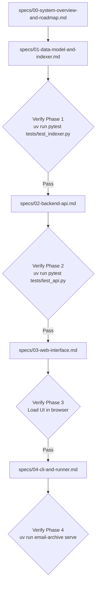

# AI Tool Execution Guide & Handoff Playbook

## 1. Overview & Handoff Strategy

This document provides exact, battle-tested instructions and prompt sequences to pass these specifications into **any AI coding tool**—whether it is Antigravity, Claude Code, Cursor, Aider, Windsurf, Codex, or GitHub Copilot CLI.

### Guiding Principles for the AI Agent
1. **Read-Only Archive Inviolability:** Archives under `data/` (your own mail; git-ignored) must **never be modified, unpacked to loose files, or corrupted**. All reads are in-place using `pypff`.
2. **Execution Runtime:** All scripts, tests, dependencies, and servers **must run strictly via `uv`** (e.g. `uv run`, `uv run pytest`). Never prompt the user to install global Python packages or system dependencies.
3. **Zero Frontend Toolchain:** The web frontend is pure modern HTML5, CSS3, and ES6 JavaScript. Do not introduce Node.js, npm, webpack, vite, or complex build pipelines.
4. **Phase Isolation:** Implement each component in strict sequence. Verify tests before advancing to the next phase.



---

## 2. Technical Watchouts & Gotchas for AI Coding Tools

External AI tools often stumble on low-level binary format libraries. Share these specific notes with the tool:

1. **`libpff-python` (`pypff`) Characteristics:**
   - Package name on PyPI is `libpff-python`, but imported in Python as `import pypff`.
   - `pst = pypff.file(); pst.open("path/to/archive.pst")`.
   - Folder traversal is hierarchical: `root = pst.get_root_folder()`, `folder.get_number_of_sub_folders()`, `folder.get_sub_folder(i)`.
   - Message count: `folder.get_number_of_sub_messages()`, message: `folder.get_sub_message(i)`.
   - Message bodies: `msg.get_plain_text_body()` returns `bytes` or `None`. Always decode with fallback: `body.decode("utf-8", errors="replace")` or `body.decode("cp1252", errors="replace")`.
   - Attachments: `att.get_long_filename()`, `att.get_size()`, `att.read_buffer(size)`.
   - Recipients: `msg.recipients.get_number_of_recipients()`, `r = msg.recipients.get_recipient(i)`. Standard MAPI properties: `0x3001` (PR_DISPLAY_NAME), `0x3003` (PR_EMAIL_ADDRESS), `0x0c15` (PR_RECIPIENT_TYPE).
2. **SQLite FTS5 Support:**
   - Python's standard library `sqlite3` on Linux has FTS5 built-in. Use `CREATE VIRTUAL TABLE messages_fts USING fts5(...)`.
3. **PST File Thread Safety:**
   - Open a single dedicated `PstReader` instance or protect reads with a standard Python threading lock.

---

## 3. Step-by-Step AI Execution Prompts

Copy and paste each prompt block into your AI coding tool one phase at a time.

---

### Step 1: Project Setup & Core Data Engine (Phase 1)

> **Prompt to pass to AI tool:**
> 
> ```markdown
> You are implementing Phase 1 of the Email Archive Explorer for an ANSI Outlook PST file.
> 
> Please read the following specification files carefully:
> 1. `specs/00-system-overview-and-roadmap.md`
> 2. `specs/01-data-model-and-indexer.md`
> 
> Your tasks for this phase:
> 1. Create `pyproject.toml` using `uv` standards with dependencies: `libpff-python`, `fastapi`, `uvicorn`, `pydantic`, and optional dev dependencies: `pytest`, `httpx`.
> 2. Create the package structure under `src/email_archive_explorer/`:
>    - `models.py`: Data models for folders, messages, recipients, and attachments.
>    - `reader.py`: Thread-safe `PstReader` class wrapping `pypff` for in-place read-only PST access and attachment streaming.
>    - `indexer.py`: Scans the PST, extracts metadata and bodies, and builds `archive_cache.db` with SQLite and an FTS5 full-text search table.
> 3. Create unit tests in `tests/test_indexer.py` verifying that:
>    - the demo archive (`uv run email-archive demo`) and any PST you supply can be opened and parsed.
>    - Folder hierarchy is extracted correctly.
>    - Attachments can be read as byte streams.
>    - SQLite FTS5 search functions properly.
> 
> Requirements:
> - Never modify or extract files from archives under `data/`.
> - Run all commands using `uv run`.
> - Ensure `uv run pytest tests/test_indexer.py -v` passes before finishing.
> ```

**Validation Command to Run:**
```bash
uv run pytest tests/test_indexer.py -v
```

---

### Step 2: Backend REST API (Phase 2)

> **Prompt to pass to AI tool:**
> 
> ```markdown
> You are implementing Phase 2 of the Email Archive Explorer. Phase 1 (data model and indexer) is already implemented and verified.
> 
> Please read the following specification file carefully:
> - `specs/02-backend-api.md`
> 
> Your tasks for this phase:
> 1. Implement `src/email_archive_explorer/api.py` using FastAPI:
>    - `GET /api/archive/info`: Archive metadata and statistics.
>    - `GET /api/folders`: Hierarchical folder tree with message counts.
>    - `GET /api/folders/{folder_id}/messages`: Paginated message list with sorting and filtering.
>    - `GET /api/messages/{message_id}`: Message detail, recipients, body, attachment list.
>    - `GET /api/messages/{message_id}/attachments/{attachment_id}`: Stream attachment binary with proper MIME type and content disposition (`inline` or `attachment`).
>    - `GET /api/messages/{message_id}/eml`: Synthesize RFC 822 `.eml` format for export.
>    - `GET /api/search`: SQLite FTS5 search with highlighted snippets.
> 2. Implement lifespan management to initialize `archive_cache.db` and the `PstReader` on startup and cleanly close on shutdown.
> 3. Create test suite `tests/test_api.py` using `pytest` and `httpx`.
> 
> Requirements:
> - All tests must be executed with `uv run pytest tests/test_api.py -v`.
> - Ensure all endpoints return appropriate HTTP status codes and error responses.
> ```

**Validation Command to Run:**
```bash
uv run pytest tests/test_api.py -v
```

---

### Step 3: Web UI Frontend (Phase 3)

> **Prompt to pass to AI tool:**
> 
> ```markdown
> You are implementing Phase 3 of the Email Archive Explorer. Phases 1 and 2 are complete.
> 
> Please read the following specification file carefully:
> - `specs/03-web-interface.md`
> 
> Your tasks for this phase:
> 1. Create the static frontend assets under `src/email_archive_explorer/static/`:
>    - `index.html`: Clean 3-pane layout (Folder Tree | Message List | Reading Pane).
>    - `css/app.css`: Modern desktop email client styling with responsive flex/grid, dark/light theme support, and typography.
>    - `js/api.js`: REST client calling `/api/*` endpoints.
>    - `js/tree.js`: Collapsible folder tree rendering and selection state.
>    - `js/viewer.js`: Email reading view, attachment download pills, URL linkification, and image lightbox preview.
>    - `js/app.js`: Main controller managing state, keyboard shortcuts (`j`/`k`/`/`/`Esc`), and search bar debouncing.
> 2. Mount static directory in `src/email_archive_explorer/api.py` to serve `/` and `/static`.
> 
> Requirements:
> - Pure HTML5/CSS3/JavaScript only. No Node.js, npm, or build tools.
> - Fast, polished, and intuitive interface.
> ```

**Validation Command to Run:**
```bash
uv run uvicorn email_archive_explorer.api:app --port 8000
# Then open http://127.0.0.1:8000 in your browser to verify
```

---

### Step 4: Unified CLI Runner & Packaging (Phase 4)

> **Prompt to pass to AI tool:**
> 
> ```markdown
> You are implementing Phase 4 of the Email Archive Explorer.
> 
> Please read the following specification file carefully:
> - `specs/04-cli-and-runner.md`
> 
> Your tasks for this phase:
> 1. Implement `src/email_archive_explorer/cli.py`:
>    - Command `email-archive serve`: Checks/builds cache, starts server, displays terminal banner, auto-opens default web browser.
>    - Command `email-archive index`: Builds or updates index.
>    - Command `email-archive stats`: Prints formatted statistics of the archive.
>    - Command `email-archive export`: Batch exports folder/archive to `.eml` files.
> 2. Register `email-archive = "email_archive_explorer.cli:main"` in `pyproject.toml`.
> 3. Verify end-to-end execution with `uv run email-archive stats` and `uv run email-archive serve`.
> ```

**Validation Command to Run:**
```bash
uv run email-archive demo
uv run email-archive stats data/demo/larkspur-mail
uv run email-archive serve data/demo/larkspur-mail
```

---

### Step 5: Advanced Search, Threading & ZIP Export (Phase 5)

> **Prompt to pass to AI tool:**
> 
> ```markdown
> You are implementing Phase 5 of the Email Archive Explorer.
> 
> Please read `specs/05-advanced-features-and-analytics.md` carefully.
> 
> Your tasks:
> 1. Enhance `src/email_archive_explorer/indexer.py` with multi-criteria search (date ranges, senders, attachment extensions), thread grouping (`get_message_thread`), and analytics aggregation (`get_archive_analytics`).
> 2. Add endpoints in `src/email_archive_explorer/api.py`:
>    - `GET /api/messages/{id}/thread`
>    - `GET /api/archive/analytics`
>    - `GET /api/folders/{id}/zip` (streaming ZIP)
>    - `GET /api/search/zip` (streaming ZIP)
> 3. Update the UI:
>    - Advanced filter drawer (`🔍 Filters`)
>    - Conversation thread pills in reading pane
>    - In-app text/code document viewer
>    - Visual timeline analytics modal (`📊`)
>    - Folder/search ZIP export buttons
> 4. Verify with `uv run pytest tests/test_advanced.py -v`.
> ```

---

### Step 6: Multi-Archive Manager & File Open Menu (Phase 6)

> **Prompt to pass to AI tool:**
> 
> ```markdown
> You are implementing Phase 6 of the Email Archive Explorer.
> 
> Please read `specs/06-multi-archive-manager-and-file-menu.md` carefully.
> 
> Your tasks:
> 1. Implement `src/email_archive_explorer/manager.py`:
>    - `ArchiveManager` managing catalog database (`catalog.db`) and dynamic active archive switching.
>    - Auto-discovery scanning of `data/` directory for archive files.
>    - Isolated per-archive SQLite cache management.
> 2. Implement API endpoints in `src/email_archive_explorer/api.py`:
>    - `GET /api/archives`: List discovered and registered archives with active state.
>    - `POST /api/archives/open`: Switch active archive dynamically.
>    - `POST /api/archives/scan`: Rescan directories for archives.
> 3. Enhance UI in `index.html`, `app.css`, and `app.js`:
>    - Top navigation "Archives" dropdown menu.
>    - "Open File Path..." modal.
>    - "Rescan Data Folder" button.
> 4. Create `tests/test_archive_manager.py` verifying dynamic switching and catalog discovery.
> ```

---

### Step 7: Pluggable Archive Drivers (Phase 7)

> **Prompt to pass to AI tool:**
> 
> ```markdown
> You are implementing Phase 7 of the Email Archive Explorer.
> 
> Please read `specs/07-pluggable-archive-driver-architecture.md` carefully.
> 
> Your tasks:
> 1. Implement driver framework in `src/email_archive_explorer/drivers/`:
>    - `base.py`: `BaseArchiveDriver` abstract class.
>    - `registry.py`: `ArchiveDriverRegistry` with magic byte probing and auto-detection.
>    - `pst_driver.py`: Refactor `PstReader` into a concrete `PstDriver`.
>    - `mbox_driver.py`: Concrete `MboxDriver` using Python's standard `mailbox.mbox`.
> 2. Decouple `indexer.py` and `api.py` from PST-specific code to rely strictly on `BaseArchiveDriver`.
> 3. Create `tests/test_drivers.py` verifying probing accuracy, driver interface compliance, and MBOX indexing.
> ```

---

### Step 8: Modernised UI, File Browser & Archive Inspector (Phase 8) ✅ implemented (verify UI changes with `scripts/ui_audit.py`)

> **Prompt to pass to AI tool:**
> 
> ```markdown
> You are implementing Phase 8 of the Email Archive Explorer.
> 
> Please read `specs/08-modern-ui-file-browser-and-archive-inspector.md` carefully,
> and work through the slices in §5 in order. Do not expose any /api/fs/* route
> until slice 8.1 (API hardening: no wildcard CORS, Host check, session token) is merged.
> 
> Your tasks:
> 1. Backend: API hardening, `fs_browser.py` (roots + confined listing + probe badges),
>    native OS picker, async archive open with job progress, `technical_details()` driver
>    hook, `GET /api/archive/details`, `POST /api/archive/checksum`.
> 2. Frontend (zero-build ES modules): design tokens + SVG icon sprite, <dialog>-based
>    File Browser, resizable/collapsible panes, Archive Inspector panel, toasts,
>    sandboxed HTML email view.
> 3. Tests: `tests/test_security.py`, `tests/test_fs_browser.py`, `tests/test_open_jobs.py`,
>    `tests/test_archive_details.py`; then run the manual UI checklist in §6.
> ```

---

### Step 9: Attachment Explorer (Phase 9) ✅ implemented

> **Prompt to pass to AI tool** (for changes or re-implementation):
> 
> ```markdown
> You are working on Phase 9 of the Email Archive Explorer.
> 
> Please read `specs/09-attachment-explorer.md` and `docs/architecture.md` §6.
> 
> Key constraints:
> 1. `attachment_catalog` is derived. Never require a reindex to change it: bump `CATALOG_VERSION` instead.
> 2. Duplicate detection is metadata-only: (lower(filename), size).
> 3. Inline attachment responses must keep `nosniff`, and `Content-Security-Policy: sandbox` for active types.
> 4. Keep `static/js/attachments.js` self-contained; it moves to `ui/attachments.js` under Spec 08 §4.6.
> 5. `uv run pytest tests/test_attachments.py` must pass.
> ```

---

## 4. Troubleshooting Reference for External AI Agents

| Issue | Root Cause | Solution |
|---|---|---|
| `AttributeError: 'pypff.attachment' has no attribute 'get_name'` | `pypff` uses `get_long_filename()` | Use `att.get_long_filename() or f"attachment_{idx}"` |
| UnicodeDecodeError when reading plain text body | ANSI PST strings are encoded in cp1252 / latin-1 | Decode with fallback chain: `utf-8` -> `cp1252` -> `latin-1` |
| `sqlite3.OperationalError: no such module: fts5` | SQLite binary without FTS5 compiled | Python 3.12 standard library on modern Linux has FTS5 built-in; verify with `import sqlite3; conn = sqlite3.connect(":memory:"); conn.execute("CREATE VIRTUAL TABLE t USING fts5(x);")` |
| Message body is empty for an email | Outlook compressed RTF used without plain text body | Parse `msg.get_rtf_body()` and strip RTF tags to extract plain text |
